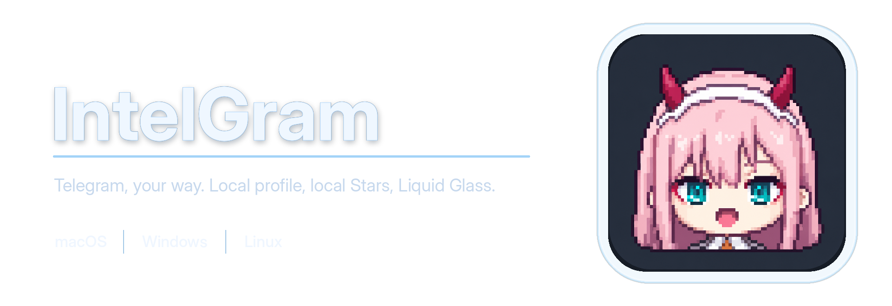

Imagine opening Telegram and your profile, your Stars balance, and the entire look of
the app are exactly how you want them — without changing anything about your account.
IntelGram is a cross-platform AyuGram Desktop build focused on local profile
customization, private on-device productivity tools, and verifiable local exports.
Everything it adds runs on your device only.

New in v21: local Stars moved into Telegram's native My Stars screen, and top-up runs
through Telegram's real 15 Stars packages with a native checkout panel. Paying credits
your on-device balance only — no real payment, no payment provider, no Telegram
payment API. See the [changelog](CHANGELOG.md).

## Installation

1. Download the latest build for your platform: [macOS Apple Silicon
   (DMG)](https://github.com/foolspec/IntelGram/releases/latest/download/IntelGram-macOS-Apple-Silicon.dmg),
   [Windows x64
   (ZIP)](https://github.com/foolspec/IntelGram/releases/latest/download/IntelGram-Windows-x64.zip),
   or [Linux x64
   (tar.gz)](https://github.com/foolspec/IntelGram/releases/latest/download/IntelGram-Linux-x64.tar.gz).
   Every release includes SHA-256 checksums, platform validation notes, and launch logs.

2. macOS: open the DMG, drag `IntelGram.app` to Applications, then Control-click
   **Open** on first launch if Gatekeeper asks. The community build is ad-hoc signed,
   not Apple-notarized. Windows: extract the ZIP and run `IntelGram.exe`, keeping the
   extracted files together. Linux: extract the tarball and run `IntelGram`.

3. Open **IntelGram Preferences** and explore the grouped settings pages — or start
   with [Local Profile](#local-profile) and [Disguise Mode](#disguise-mode) below.
   The [feature guide](FEATURE_GUIDE.md) walks through every workflow.

## Local Stars

Your on-device Stars balance lives on Telegram's native **My Stars** row in Settings.
**Top Up Balance** opens Telegram's own package list — the real 15 packages and
prices, from 100 to 150,000 Stars. Picking one opens Telegram's native checkout panel
with the demo American Express card already saved as the payment method; Pay adds the
Stars to your local balance and plays the usual success animation. Nothing is sent to
Telegram or a payment provider, and no real card details are ever asked for.

## Local Profile

Open **IntelGram Preferences -> Local Profile & Collectibles** to set a local display
name, UID, primary username, up to 20 other usernames, an anonymous number, bio, and
profile photo, plus automatic or manually selected badges, emoji status, and
organization verification. You can clone the visible profile of any user already
loaded in IntelGram by entering their UID, and showcase a public channel on your own
profile as a clearly labeled local showcase with a private posting workspace.

## Disguise Mode

Triple-click anywhere on the blue **IntelGram Desktop v...** heading in IntelGram
Preferences and the app's visible identity switches to Telegram Desktop: app name,
logo, Dock or taskbar icon, tray icon, window title, menus, About surface, and drawer
footer. Your local profile, collectibles, badges, and channel presentation stay
active. Triple-click the **Telegram Desktop** drawer footer to come back. The choice
is saved locally and sends no Telegram request.

## Appearance

### Liquid Glass

Turn on Liquid Glass in **IntelGram Preferences -> Glass & Motion** to layer adaptive
tint and contrast, wallpaper-colored diffusion, cursor-reactive specular highlights,
refractive edges, and fine grain over native desktop blur — or a removable local
whole-app image. Chat list, message surfaces, and menus can be softened
independently, and slow decorative highlights refresh at a paced 30 Hz so scrolling
and interaction stay smooth.

### Motion

Five global motion presets — Quick Snap, Smooth Flow, Diabolical, Springy, and the
optional high-elasticity Liquid Bounce — apply across transitions, dialogs, drawers,
and navigation, while reduced-motion and power-saving behavior is preserved.

### Themes and icons

Browse visual theme cards and cloud themes inside IntelGram, import or remove custom
themes, and pick any local image as the chat background with a live preview. Choose
the pink character icon, its profile-art variant, or any of twelve color variants
from the in-app icon picker.

  
  
  
  
  
  
  

## Vault and Search

Search messages, media metadata, links, and filenames already received by IntelGram
with an on-device full-text vault and a unified inbox across signed-in accounts.
Jump-to-date, conversation statistics, compact media history, saved moments, and
locally observed message edit/deletion history are built in, along with smart
folders, private contact notes and reminders, local rules, and anti-spam review.

## Exports and Backup

Export selected messages, a chat, or an account to HTML, PDF, Markdown, JSON, or ZIP.
Frozen Account Backup streams the full set and permitted downloaded files into one
AES-256-GCM encrypted archive without leaving plaintext exports behind. Telegram's
protected-content and self-destruct restrictions stay enforced throughout: protected
bodies and media are never copied into search text, rule payloads, media archives, or
backups.

## Collectibles

Browse every collection reported by Telegram's live collectible catalog, inspect
exact numbered gifts in a scrollable native grid, and paste Telegram, Getgems, or TON
item links. Feature one collectible as the local profile backdrop and pin up to six
around the local avatar. Gift detail views present your currently rendered display
name; the gift's actual ownership, sender, date, and transaction data are not
changed.

## Local Channels

Enable **Local ownership** from any broadcast channel's **IntelGram** submenu to
reveal the native broadcast composer and Manage actions, then place persistent local
text broadcasts directly in that channel's real timeline with native reply, edit,
pin, reaction, copy, delete, and selection controls. The ownership panel's Broadcast
engagement editor sets starting views, a maximum, increment size, interval, baseline
reactions, and a paid-Star display count. Nothing is sent to Telegram: views and
reaction clicks update only this client, and media, voice, stickers, and scheduled
posts stay blocked so nothing can upload.

## Local means local

These controls only change how your own profile is rendered inside this IntelGram
installation. They do not change your Telegram display name, photo, bio, username,
UID, phone number, emoji status, collectible ownership, or profile data. Other
Telegram users do not see the local overrides. The implementation contains no
Telegram account/profile mutation request, contact import, automatic channel join,
server-side channel ownership or permission mutation, or collectible transaction.

## Builds and verification

All packages are built from the official AyuGram Desktop `v6.7.8` source at commit
`b25513a06ff88be0b3f4c928252b56c3da39cec7`, with its required submodules. IntelGram
uses its own visible application name, macOS bundle ID, Windows application ID, and
Linux desktop ID so it can coexist with a normal AyuGram installation.

- [`intelgram-local-profile-render-overrides.patch`](intelgram-local-profile-render-overrides.patch)
  contains the complete IntelGram implementation.
- Patch SHA-256: `c7befba853cc1917df39417fbfb8eed2847a53ccd2d9f9a9a703fac999d42513`
- The patch pins [`foolspec/lib_ui`](https://github.com/foolspec/lib_ui) commit
  `b9a30917daf2bd8fdc17ccd9682acca178882b7b`, which carries the shared motion-preset
  hook and Liquid Bounce transition.
- [`build_intelgram_branding.py`](build_intelgram_branding.py) applies the
  cross-platform IntelGram product identity.
- [`validate_intelgram_patch.py`](validate_intelgram_patch.py) verifies the feature
  hooks, protected-content boundaries, and absence of custom Telegram mutation
  requests before each platform build.
- [`FEATURES.md`](FEATURES.md) documents the complete custom feature surface;
  [`CHANGED_FILES.md`](CHANGED_FILES.md) lists every source path changed by the
  patch; [`TECHNICAL_CHANGELOG.md`](TECHNICAL_CHANGELOG.md) and
  [`UPDATE_LOG.md`](UPDATE_LOG.md) track implementation and build changes.

## Credits

IntelGram is based on [AyuGram Desktop](https://github.com/AyuGram/AyuGramDesktop),
which is based on [Telegram Desktop](https://github.com/telegramdesktop/tdesktop).
Their upstream licenses and attribution remain in the source.

IntelGram custom features by **fool**.
